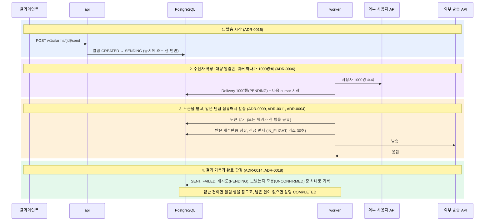

# 대량 알림 발송 서버

외부 발송 API와 연동하여 다수의 수신자에게 알림을 발송하고 수신자별 발송 상태를 추적하는 NestJS 기반 백엔드 시스템입니다. HTTP 요청을 처리하는 `api` 서버와 실제 발송을 수행하는 `worker` 프로세스로 분리되어 있으며, 발송 상태·작업 큐·처리량 제한 상태는 모두 단일 PostgreSQL에 저장합니다.

주요 설계 결정과 대안 검토 내역은 [ADR 목록](docs/adr/README.md)에 정리되어 있습니다.

## 실행

Docker(Compose v2) 환경에서 단일 명령으로 전체 스택을 실행합니다.

```bash
docker compose up
```

`postgres`, `mock`(외부 발송 API 서버), `migrate`(스키마 마이그레이션 실행 후 종료), `api`, `worker`(기본 2대) 컨테이너가 의존 순서대로 기동됩니다.

| 항목             | 값                                                                           |
| ---------------- | ---------------------------------------------------------------------------- |
| API 주소         | http://localhost:3000                                                        |
| 인증 헤더        | `Authorization: Bearer dev-api-key` (개발 기본값, `API_KEY` 환경변수로 변경) |
| Swagger UI       | http://localhost:3000/docs                                                   |
| OpenAPI 3.0 명세 | http://localhost:3000/docs/openapi.json ([정적 파일](docs/openapi.json))     |

워커 인스턴스 수 조정 및 Prometheus(http://localhost:9090) 메트릭 수집 프로필 실행:

```bash
docker compose up --scale worker=3
```

```bash
docker compose --profile monitoring up
```

헬스체크(`/health/*`)와 메트릭(`/metrics`)은 컨테이너 내부 관리 포트(`9100`)로 분리되어 있으며 호스트 외부로 노출하지 않습니다. 환경변수 목록과 기본값은 [app-config.ts](src/shared/config/app-config.ts)에 정의되어 있습니다.

## 테스트

모든 테스트는 컨테이너 환경에서 실행됩니다.

| 명령                                                                | 검증 내용                                                                                                                     | 결과                  |
| ------------------------------------------------------------------- | ----------------------------------------------------------------------------------------------------------------------------- | --------------------- |
| `docker compose --profile test run --rm test`                       | ESLint, Prettier, 단위·통합 테스트 211개 (실제 PostgreSQL 사용)                                                               | 통과                  |
| `docker compose --profile test run --rm test npm run test:mutation` | Stryker 변이 테스팅 (도메인·클라이언트 순수 로직 대상)                                                                        | 97.3% (기준선 90%)    |
| `docker compose --profile test run --rm test npm run test:sabotage` | 결함 주입(Sabotage) 테스트: 핵심 안전장치(펜싱, 리스, 행 잠금 등) 제거 시 테스트 실패 여부 검증                               | 52 / 52 검출          |
| `bash scripts/e2e.sh`                                               | E2E(사용자 2,000명, 워커 3대): 발송 중 워커 1대 정상 종료(SIGTERM), 1대 강제 종료(SIGKILL), 긴급 알림 우선 발송, 발송 중 취소 | 중복 0, 누락 0, 429 0 |
| `bash scripts/e2e-faults.sh`                                        | E2E 장애 주입: 발송 중 mock 일시 정지, 워커 일시 정지, PostgreSQL 재시작                                                      | 중복 0, 누락 0        |

E2E 스크립트는 실행 시 기존 Compose 스택과 볼륨을 초기화한 뒤 테스트 전용 스택을 기동합니다. 상세 테스트 구성과 실행 결과는 [docs/testing.md](docs/testing.md)를 참고하십시오.

## API 명세

`/v1/*` 경로의 모든 엔드포인트는 `Authorization: Bearer <API_KEY>` 헤더를 요구합니다.

| 메서드 | 경로                         | 설명                                                             |
| ------ | ---------------------------- | ---------------------------------------------------------------- |
| POST   | `/v1/alarms`                 | 알림 생성 (`CREATED` 상태로 저장되며 즉시 발송되지 않음)         |
| GET    | `/v1/alarms`                 | 알림 목록 조회 (최신순, 커서 페이지네이션, `status`·`type` 필터) |
| GET    | `/v1/alarms/{id}`            | 알림 단건 조회 (수신자 상태별 집계 `counts` 포함)                |
| POST   | `/v1/alarms/{id}/send`       | 알림 발송 시작                                                   |
| POST   | `/v1/alarms/{id}/cancel`     | 알림 발송 취소                                                   |
| GET    | `/v1/alarms/{id}/deliveries` | 수신자별 발송 내역 조회 (`status` 필터, 커서 페이지네이션)       |

### 상태 모델

```
CREATED ──발송 시작──▶ SENDING ──전체 Delivery 처리 완료──▶ COMPLETED
   │                      │
   │ 취소                  │ 취소 요청 / 수신자 확장 영구 오류
   ▼                      ▼
CANCELED ◀──잔여 건 정리── CANCELING
```

- 일부 수신자 발송이 영구 실패(`FAILED`)하더라도 모든 수신자에 대한 처리가 종료되면 알림 상태는 `COMPLETED`가 됩니다.
- 발송 중 취소 요청 시 `CANCELING`으로 먼저 전환되어 신규 발송 점유가 즉시 중단됩니다. 대기 중인 건이 `CANCELED`로 정리되고 이미 전송 중이던 요청의 결과가 모두 확정되면 최종적으로 `CANCELED`로 전환됩니다.
- 수신자별 발송 상태(`Delivery.status`)는 `PENDING`(대기), `IN_FLIGHT`(전송 중), `UNCONFIRMED`(응답 미수신·결과 조회 대기), `SENT`(발송 완료), `FAILED`(실패), `CANCELED`(취소) 6가지입니다.

### HTTP 상태 코드

| 상황                                                                       | 상태 코드                                              |
| -------------------------------------------------------------------------- | ------------------------------------------------------ |
| 알림 생성                                                                  | `201 Created` (`Location` 헤더 포함)                   |
| 발송 시작·취소 요청 후 비동기 처리 진행 중 (`SENDING`, `CANCELING`)        | `202 Accepted`                                         |
| 발송 시작·취소 요청 시 이미 완료·취소된 상태이거나 단건·목록 조회          | `200 OK`                                               |
| 입력 검증 실패 (필드 누락·제약 위반, 잘못된 UUID·커서 형식)                | `400 Bad Request`                                      |
| API 키 누락 또는 불일치                                                    | `401 Unauthorized`                                     |
| 존재하지 않는 알림 ID 또는 경로                                            | `404 Not Found`                                        |
| 등록된 경로이나 허용되지 않은 HTTP 메서드                                  | `405 Method Not Allowed` (`Allow` 헤더 포함)           |
| 현재 상태에서 허용되지 않는 전이 (취소된 알림 발송 시작, 완료된 알림 취소) | `409 Conflict`                                         |
| 요청 본문 크기 초과 / `Content-Type`이 `application/json`이 아님           | `413 Payload Too Large` / `415 Unsupported Media Type` |
| DB 연결 획득 또는 쿼리 타임아웃                                            | `503 Service Unavailable`                              |

발송 시작(`send`)과 취소(`cancel`)는 멱등하게 동작합니다. 이미 목표 상태에 도달한 경우 오류 대신 현재 상태를 반환하므로, 응답을 받지 못한 클라이언트는 동일 요청을 재전송할 수 있습니다. 모든 에러 응답은 RFC 9457 Problem Details(`application/problem+json`) 형식을 따르며, 응답 본문의 `traceId`를 통해 서버 로그를 추적할 수 있습니다.

### 요청 및 응답 예시

긴급 알림 생성 (`BULK` 타입은 `recipientIds`를 지정하지 않음):

```bash
curl -i -X POST http://localhost:3000/v1/alarms \
  -H 'Authorization: Bearer dev-api-key' -H 'Content-Type: application/json' \
  -d '{"type":"URGENT","title":"서버 점검 안내","body":"오늘 23시부터 30분간 점검합니다","recipientIds":["u_000001","u_000002"]}'
```

```http
HTTP/1.1 201 Created
Location: /v1/alarms/01a14146-58cc-726c-84e1-d6dbcbe9ff46

{ "id": "01a14146-58cc-726c-84e1-d6dbcbe9ff46", "type": "URGENT", "status": "CREATED", ... }
```

발송 시작:

```bash
curl -i -X POST http://localhost:3000/v1/alarms/01a14146-58cc-726c-84e1-d6dbcbe9ff46/send \
  -H 'Authorization: Bearer dev-api-key'
```

```http
HTTP/1.1 202 Accepted

{ "id": "01a14146-58cc-726c-84e1-d6dbcbe9ff46", "status": "SENDING", "startedAt": "2026-10-15T20:34:51.734Z", ... }
```

대량 알림(2,000명) 발송 중 취소 완료 후 단건 조회 (`GET /v1/alarms/{id}`, 실제 발송 성공 목록은 `/deliveries?status=SENT`로 조회):

```json
{
  "id": "01a14146-62b1-7db9-b08c-138594538f03",
  "type": "BULK",
  "status": "CANCELED",
  "counts": {
    "total": 2000,
    "pending": 0,
    "inFlight": 0,
    "unconfirmed": 0,
    "sent": 355,
    "failed": 3,
    "canceled": 1642
  }
}
```

완료된 알림에 대한 취소 요청(409 에러 응답):

```json
{
  "type": "/problems/invalid-state",
  "title": "Not allowed in the current state",
  "status": 409,
  "detail": "An alarm in COMPLETED cannot be canceled",
  "instance": "/v1/alarms/01a14146-58cc-726c-84e1-d6dbcbe9ff46/cancel",
  "currentStatus": "COMPLETED",
  "traceId": "8b586a77afa5b4f6c9864b9dd9e718e9"
}
```

## 아키텍처 및 핵심 설계

```
Client ──HTTP──▶ api ──▶ ┌──────────────── PostgreSQL ────────────────┐ ◀── worker × N ──▶ 외부 발송 API
                         │ alarms           알림 메타데이터 및 상태     │        │
                         │ alarm_recipients 긴급 알림 지정 수신자 목록  │        └──▶ 외부 사용자 API
                         │ deliveries       수신자별 발송 상태 (작업 큐) │
                         │ rate_limiter     워커 공유 토큰 버킷 (단일 행)│
                         └────────────────────────────────────────────┘
```

`api`와 `worker`는 직접 통신하지 않고 PostgreSQL을 통해서만 상태를 공유합니다.

1. **발송 시작**: `POST /v1/alarms/{id}/send` 요청 시 조건부 UPDATE(`WHERE status = 'CREATED'`)로 상태를 `SENDING`으로 전환합니다. 동시 요청이 들어와도 단 한 번만 전이됩니다(ADR-0016).
2. **수신자 확장(Expansion)**: 단일 워커가 해당 대량 알림의 확장 소유권(`expansion_owner`, 리스 30초)을 획득하고, 외부 사용자 API를 1,000명 단위로 조회하며 `deliveries` 행 삽입과 다음 커서(`expansion_cursor`) 갱신을 단일 트랜잭션으로 커밋합니다. 커밋된 `Delivery`는 전체 확장이 끝나기 전이라도 즉시 발송 대상이 됩니다(ADR-0006).
3. **토큰 획득 및 작업 점유(Claim)**: 모든 워커는 `rate_limiter` 테이블에서 발송 토큰을 먼저 획득한 뒤, 획득한 토큰 수만큼 `FOR UPDATE SKIP LOCKED`로 `PENDING` 상태의 `Delivery`를 점유(`IN_FLIGHT`)하여 외부 API로 발송합니다.
4. **결과 기록 및 완료 판정**: 각 `Delivery`가 최종 상태(`SENT`, `FAILED`, `CANCELED`)로 전환될 때 동일 트랜잭션 내에서 해당 `alarms` 행을 잠그고(`FOR UPDATE`), 미완료 건(`PENDING`, `IN_FLIGHT`, `UNCONFIRMED`)이 남아 있지 않으면 알림 상태를 `COMPLETED`(또는 `CANCELED`)로 전환합니다(ADR-0018).



### 중복 및 누락 방지

외부 발송 API는 멱등성을 보장하지 않으므로(동일 `clientRef` 재전송 시 중복 발송됨), 전송 성공 여부를 확신할 수 없는 요청을 즉시 재전송하지 않도록 설계했습니다.

1. **미확정 건 발송 내역 대조(Reconciliation)**: 요청 바이트가 소켓에 기록된 이후 발생한 타임아웃(10초)이나 연결 끊김은 `UNCONFIRMED` 상태로 전환합니다. 5초(`RECONCILE_DELAY_MS`) 경과 후 `GET /v1/messages?clientRef={alarmId}:{recipientId}`로 외부 발송 기록을 조회하여, 기록이 존재하면 `SENT`로 확정하고 기록이 없음을 확인한 경우에만 `PENDING`으로 되돌려 재발송합니다(ADR-0002, ADR-0037).
2. **리스(Lease) 기반 소유권 회수(Takeover)**: 워커가 점유한 `Delivery`에는 30초 만료 기한(`lease_until`)을 부여합니다. 워커 크래시나 일시 정지(GC, 컨테이너 일시 중지 등)로 기한 내 결과를 기록하지 못하면, 다른 워커가 만료된 건을 `UNCONFIRMED`로 전환하고 소유권(`owner`)을 회수한 뒤 1번의 내역 조회 절차를 거칩니다(ADR-0004, ADR-0007).
3. **펜싱(Fencing)**: 결과 기록 쿼리는 `WHERE id = $1 AND status = 'IN_FLIGHT' AND owner = $2 AND attempts = $3` 조건을 검사합니다. 리스 만료로 소유권이 회수된 뒤 뒤늦게 깨어난 워커의 쓰기는 조건 불일치(0건 갱신)로 거부됩니다.
4. **소켓 기록 직전 리스 검증 및 한계**: HTTP 커넥션 풀 대기 중 워커가 멈췄다가 깨어나는 경우를 막기 위해, 소켓에 요청 바이트를 쓰기 직전 남은 리스 시간이 응답 타임아웃(10초)보다 큰지 재확인합니다. 단, 이 검사를 통과한 직후 커널 버퍼에 기록하기 전의 극히 짧은 구간에서 워커가 15초(남은 리스 10초 + 조회 대기 5초) 이상 멈췄다가 깨어나면 중복 발송이 발생할 수 있습니다. 이 경우 펜싱 실패 후 내역 조회를 통해 중복을 감지하여 `alarm_duplicates_detected_total` 메트릭과 에러 로그를 남깁니다. 프로세스 외부 격리(STONITH)는 컨테이너에 호스트 권한(`docker.sock`) 부여가 필요하므로 애플리케이션 범위에서 제외했습니다(ADR-0004).

### 처리량 제한 공유 (Rate Limiting)

- 모든 워커가 PostgreSQL `rate_limiter` 테이블의 단일 행을 공유합니다. 초당 50개 충전 속도(lazy refill)로 동작하며, 별도 충전 타이머 없이 토큰 요청 시 경과 시간(`clock_timestamp() - refilled_at`)만큼 계산하여 차감합니다(ADR-0009).
- 내부 버킷 용량은 `10`으로 설정했습니다. 외부 mock 서버의 버킷 용량(`50`)보다 작게 제한하여, 네트워크 지연 편차로 인해 여러 워커의 요청이 순간적으로 몰려 도착하더라도 외부 버킷의 여유분(약 40개)이 버스트를 흡수하도록 했습니다.
- 외부 API로부터 `429 Too Many Requests` 수신 시 `Retry-After`만큼 `paused_until`을 갱신하여 전체 워커의 토큰 획득을 동시에 일시 정지합니다.

### 긴급 알림 우선 처리

- 워커는 토큰을 먼저 획득한 뒤, 획득한 개수만큼만 `ORDER BY priority ASC, start_seq ASC, id ASC` 순서로 `Delivery`를 점유합니다(긴급 `priority = 0`, 대량 `priority = 1`, ADR-0011).
- 대량 발송 중 긴급 알림이 시작되면 다음 토큰 생성 시점(평소 수십 ms, 버스트 직후 최대 200ms)에 긴급 건이 즉시 먼저 점유됩니다.
- 이미 전송 중이거나 재시도 대기 중인 긴급 건을 기다리느라 대량 발송을 중단하지는 않으므로 전체 처리량 손실이 발생하지 않습니다. 동일 우선순위 내에서는 발송 시작 순번(`start_seq`) 기준 FIFO로 처리합니다(ADR-0012).

### 워커 다중화 및 종료 처리

- 작업 분배는 `FOR UPDATE SKIP LOCKED`, 처리량 제어는 공유 토큰 버킷, 장애 복구는 리스 만료 회수(`Takeover`)로 처리하여 워커 간 직접 통신이나 리더 선출 없이 수평 확장(`--scale worker=N`)됩니다.
- **정상 종료(`SIGTERM`)**: 신규 점유를 중단하고, 이미 전송 중인 HTTP 요청은 응답(최대 20초 대기)을 받아 결과를 기록하며, 아직 전송하지 않은 건은 즉시 `PENDING`으로 반납하여 불필요한 리스 만료 대기를 방지합니다.
- **비정상 종료 및 멈춤(`SIGKILL`, 크래시, OOM, 네트워크 단절)**: 30초 리스 만료 후 다른 워커가 회수하여 발송 내역 조회를 거쳐 안전하게 이어받습니다(ADR-0007).
- 기본 워커 수는 단일 워커 장애 시에도 발송이 중단되지 않도록 2대로 설정했습니다(ADR-0010).

### 외부 장애 대응 및 서킷 브레이커

- **지수 백오프 재시도**: `500`, `503` 및 연결 실패는 1초부터 최대 60초까지 지수 백오프(±20% 지터)로 최대 8회 시도한 뒤 `FAILED`로 확정합니다. `429`는 속도 제어 문제이므로 시도 횟수(`attempts`)에서 제외합니다(ADR-0014).
- **서킷 브레이커 및 단건 프로브(Probe)**: 최근 시작한 발송 20건 중 50% 이상이 일시 오류 또는 타임아웃이면 브레이커를 열어(`breaker_open = true`) 전체 워커를 일시 정지(5초~최대 60초)합니다. 정지 시간이 지나면 전체 워커를 통틀어 단 1건의 프로브(시험 발송)만 허용하며, 성공 시 브레이커를 닫고 실패 시 정지 시간을 배가합니다.
- **장기 장애 시 누락 방지**: 브레이커가 열린 동안 발생한 일시 오류는 외부 서비스 전면 장애로 간주하여 시도 횟수(`attempts`)를 차감하지 않고 대기 상태로 되돌립니다.
- 외부 서버의 `GET /health`는 컨테이너 기동 순서 제어에만 사용하며, 발송 API만 실패하는 부분 장애를 감지할 수 없으므로 서킷 브레이커 판단에는 실제 발송 결과만 사용합니다.

### 운영 고려사항

- **예외 경계 및 타임아웃**: 예상치 못한 예외는 프로세스 핸들러, HTTP 전역 예외 필터, 워커 `PollingLoop` 최상위에서 포착하여 로그와 메트릭을 남기고 프로세스를 유지합니다. `api`의 DB 풀에는 연결 획득 한도(5초)와 쿼리 타임아웃(10초)을 두어 DB 장애 시 무한 대기 대신 `503`을 즉시 반환합니다(ADR-0039). 워커 트랜잭션에는 `idle_in_transaction_session_timeout`(5초)을 설정하여, 멈춘 워커가 행 잠금을 점유한 채 전체 발송을 차단하는 현상을 방지합니다(ADR-0004).
- **헬스체크 분리**: `api`의 `/health/live`는 DB 상태를 검사하지 않아 일시적인 DB 장애로 컨테이너가 연쇄 재시작되는 것을 방지하며, `/health/ready`에서만 DB 연결을 확인합니다. `worker`의 생존 여부는 모든 폴링 루프가 최근 30초 이내에 정상 회전했는지로 판정합니다(ADR-0026).
- **구조화 로그 및 민감정보 마스킹**: 표준 출력 JSON 로그에 `traceId`, `alarmId`, `deliveryId`를 자동 주입하며, 본문 내 4자리 이상 연속 숫자(인증번호 등), 전화번호, 비밀키, DB 접속 URL 내 비밀번호를 로거 계층에서 일괄 마스킹합니다(ADR-0028).
- **설정 교차 검증**: 기동 시 환경변수 타입뿐 아니라 설정 간 불변식(예: `HTTP 응답 타임아웃 < 발송 리스 기한`)을 검증하여 위반 시 기동을 중단합니다(ADR-0030).
- **DB 계정 권한 분리**: 마이그레이션 전용 컨테이너(`migrate`)만 DDL 권한 계정을 사용하며, `api`와 `worker`는 DML 권한만 가진 계정으로 실행합니다(ADR-0025).

## 성능 및 장애 테스트 실측 결과

| 항목                          | 테스트 조건                                                                                    | 측정 결과                                                                         |
| ----------------------------- | ---------------------------------------------------------------------------------------------- | --------------------------------------------------------------------------------- |
| 기본 처리량                   | 사용자 2,000명, 워커 2대                                                                       | 초당 49.1건 (상한 50건/s), 429 0건                                                |
| 10만 명 발송 + 복합 장애 주입 | 사용자 100,000명, 워커 2대, 발송 중 워커 45초 일시 정지 2회, mock 25초 정지, PostgreSQL 재시작 | 36분 내 완료. 수신 거부 999명 제외 99,001명 전원 정확히 1회 수신 (중복 0, 누락 0) |
| 긴급 알림 우선 처리           | 대량 2,000명 발송 중 긴급 알림 발송 요청                                                       | 요청 후 120ms 이내 전량 발송 완료                                                 |
| 외부 API 장시간 단절          | 사용자 3,000명, 발송 중 mock 네트워크 300초 차단 후 복구                                       | 자동 복구 후 완료, 중복 0, 누락 0                                                 |
| DB 부하                       | 초당 49건 발송, 워커 2대                                                                       | 초당 커밋 185회, `rate_limiter` 행 HOT 갱신 초당 72회                             |

## 기술 스택 및 선택 사유

| 영역                      | 기술                                                   | 선택 사유                                                                                                                                                 |
| ------------------------- | ------------------------------------------------------ | --------------------------------------------------------------------------------------------------------------------------------------------------------- |
| 런타임·프레임워크         | Node.js 24 LTS, TypeScript, NestJS 12                  | 단일 코드베이스·이미지로 `api`, `worker`, `migrate` 진입점 분리 운용(ADR-0025, ADR-0037)                                                                  |
| 데이터베이스·큐·속도 제한 | PostgreSQL 18                                          | 발송 상태 저장소, 작업 큐(`SKIP LOCKED`), 공유 토큰 버킷을 단일 데이터 저장소로 통합(ADR-0003)                                                            |
| DB 접근 계층              | Drizzle ORM (`pg` 드라이버)                            | `FOR UPDATE SKIP LOCKED`, 조건부 UPDATE, `NOT EXISTS`, 부분 인덱스 등 SQL 제어가 직관적이며 엔티티 전체 덮어쓰기로 인한 Lost Update 위험이 없음(ADR-0036) |
| 외부 HTTP 클라이언트      | `node:http` (`http.Agent`)                             | 외부 의존성 없이 커넥션 풀 크기(50)와 소켓 쓰기 직전 리스 검증, 커널 버퍼 플러시(`finish` 이벤트) 여부를 직접 제어(ADR-0037)                              |
| 설정·검증·문서화          | `@nestjs/config`, `class-validator`, `@nestjs/swagger` | NestJS 표준 구성 기반 환경변수 검증, DTO 화이트리스트 검증, OpenAPI 3.0 문서 생성                                                                         |
| 메트릭·테스트             | `prom-client`, Jest, Stryker                           | Prometheus 메트릭 노출, 단위·통합 테스트 및 변이 테스팅                                                                                                   |

상태가 여러 인프라에 분산될 때 발생하는 동기화 복잡도와 장애 지점을 줄이기 위해 외부 인프라(Redis 등) 추가 없이 PostgreSQL의 트랜잭션과 잠금 기능으로 큐와 속도 제한을 구현했습니다(ADR-0003, ADR-0005).

| 일반적 대안                     | 본 프로젝트 구현                                          | 근거                                                                                                                                                                                                                                            |
| ------------------------------- | --------------------------------------------------------- | ----------------------------------------------------------------------------------------------------------------------------------------------------------------------------------------------------------------------------------------------- |
| BullMQ + Redis 큐               | `deliveries` 테이블 + `FOR UPDATE SKIP LOCKED`            | 수신자별 발송 상태는 어차피 DB에 영속화되어야 합니다. 별도 큐를 두면 발송 시작·취소·완료 시 DB와 큐 간 이중 쓰기 정합성 문제가 발생하며, 비멱등 외부 API의 중복 방지(내역 대조 + 펜싱)는 큐 도입 여부와 무관하게 직접 구현해야 합니다(ADR-0003) |
| Redis 기반 Rate Limiter         | PostgreSQL 단일 행 토큰 버킷                              | 초당 50건 규모에서 버킷 행 갱신은 초당 70~90회 수준의 HOT 업데이트로 처리되어 DB 병목이 발생하지 않습니다(ADR-0009)                                                                                                                             |
| 별도 코디네이터 / 하트비트 데몬 | 작업별 리스(`lease_until`) + DB 시계(`clock_timestamp()`) | 각 작업 행의 만료 시각만 DB 시계 기준으로 비교하면 모든 워커가 대등하게 장애 복구를 수행할 수 있습니다(ADR-0004)                                                                                                                                |
| OpenTelemetry SDK               | W3C `traceparent` 파서 + `AsyncLocalStorage`              | 별도 트레이스 수집 인프라 없이 표준 추적 ID 전파와 로그 연계를 수행하며, 추후 OTel 도입 시 호환됩니다(ADR-0019)                                                                                                                                 |
| `pino`                          | NestJS 11+ 내장 `ConsoleLogger` JSON 모드                 | 외부 로거 의존성 없이 구조화 JSON 출력 및 커스텀 마스킹 래퍼 구성을 충족합니다(ADR-0028)                                                                                                                                                        |

## 명세 해석

| 항목                                | 해석 및 적용 기준                                                                                                                                                                                                                                                                                  |
| ----------------------------------- | -------------------------------------------------------------------------------------------------------------------------------------------------------------------------------------------------------------------------------------------------------------------------------------------------- |
| 외부 발송 API에 `title` 필드가 없음 | 외부 API에는 `body`만 전송하며, `title`은 관리 및 조회용 식별 이름으로 사용합니다(ADR-0021)                                                                                                                                                                                                        |
| 발송 완료(`SENT`) 판정 기준         | 외부 API로부터 `202 Accepted`를 수신했거나, 미확정(`UNCONFIRMED`) 상태에서 발송 내역 조회를 통해 메시지 기록이 확인된 경우입니다(ADR-0002)                                                                                                                                                         |
| 중복 발송 없음의 기준               | 단일 알림 내에서 동일 수신자에 대해 외부 발송 API에 생성된 메시지 기록이 최대 1건임을 의미합니다                                                                                                                                                                                                   |
| 전체 사용자 확정 시점               | 대량 알림 발송 시작 후 워커가 외부 사용자 API 페이지네이션을 끝까지 순회하여 조회한 사용자 집합을 기준으로 합니다(ADR-0006)                                                                                                                                                                        |
| 일부 수신자 실패 시 알림 상태       | 모든 `Delivery`가 최종 상태(`SENT` 또는 `FAILED`)에 도달하면 알림 상태는 `COMPLETED`가 되며, 성공·실패 건수는 단건 조회의 `counts`와 `/deliveries` 엔드포인트로 확인합니다(ADR-0008)                                                                                                               |
| 발송 중 취소의 보장 범위            | 취소 상태(`CANCELING`) 커밋 이후 시작되는 점유(`claim`) 쿼리는 해당 알림의 건을 더 이상 가져가지 않습니다. 취소 커밋 직전 스냅숏으로 이미 점유된 소수의 인플라이트 건은 전송될 수 있으며, 모든 인플라이트 건의 결과가 확정된 후 `CANCELED`로 전환되어 이후 집계 수치가 변경되지 않습니다(ADR-0017) |
| 긴급 알림 우선 처리의 의미          | 토큰 획득 시점에 점유 가능한 긴급 건이 존재하면 대량 건보다 항상 먼저 점유합니다. 이미 전송 중이거나 백오프 대기 중인 긴급 건을 기다리기 위해 대량 발송을 유휴 상태로 멈추지는 않습니다(ADR-0011)                                                                                                  |

요구사항별 ADR 및 테스트 매핑은 [docs/requirements.md](docs/requirements.md)에 정리되어 있습니다.

## 구현 중 변경한 설계 결정

- **워커 장애 감지 방식을 DB 세션 잠금에서 작업별 리스(Lease)로 전환**: 초기에는 워커마다 PostgreSQL Advisory Lock을 유지하고 응답이 없는 워커의 세션을 다른 워커가 `pg_terminate_backend`로 강제 종료하는 방식을 구현했습니다. 그러나 커넥션 풀러(PgBouncer 등) 환경과 호환되지 않고 세션 종료 권한이 필요하며, 프로세스 일시 정지(GC 등)는 결국 시간 기준으로 판단해야 한다는 한계가 있어 작업 행 단위 리스(`lease_until`)와 펜싱 방식으로 단순화했습니다(ADR-0004).
- **서킷 브레이커 프로브(Probe) 및 장기 장애 시 시도 횟수 보존 추가**: 외부 API를 300초간 차단하는 테스트에서, 정지 해제 시 모든 워커가 동시에 요청을 재개하면 앞쪽 대기 건들이 재시도 횟수(8회)를 모두 소진해 누락되는 문제가 확인되었습니다. 이를 해결하기 위해 정지 해제 시 단건 프로브 발송으로 복구를 먼저 확인하고, 브레이커가 열린 동안 발생한 일시 오류는 시도 횟수를 차감하지 않도록 개선했습니다(ADR-0014).
- **실측 기반 파라미터 및 커넥션 풀 분리 조정**: 외부 mock 서버가 지연 응답 건도 접수 즉시 기록한다는 점을 실측하여 내역 조회 대기 시간(`RECONCILE_DELAY_MS`)을 30초에서 5초로 단축했습니다(ADR-0002). 또한 결과 기록 시 알림 행 잠금 대기가 DB 커넥션을 점유해 토큰 획득 루프가 지연되는 현상을 확인하고, 디스패치 루프 전용 DB 커넥션 풀(2개)을 분리하여 처리량을 초당 46.9건에서 49.1건으로 개선했습니다(ADR-0013).

## 미구현 범위 및 향후 확장 설계

- **데이터 보존 정책 및 파티셔닝**: 대량 알림 1회당 `deliveries`에 10만 행이 생성됩니다. 현재는 미완료 건만 인덱싱하는 부분 인덱스(Partial Index)를 사용하여 누적 데이터가 발송 성능에 영향을 주지 않으나, 장기 운영 시에는 `deliveries`를 월 단위 Range 파티션으로 구성해 보존 주기가 지난 파티션을 분리(drop)하고, 종료 시점의 집계 건수를 `alarms` 행에 스냅숏으로 영속화하도록 설계했습니다(ADR-0031).
- **외부 프로세스 펜싱(STONITH)**: 소켓 쓰기 직전 검사 직후에 워커가 15초 이상 멈추는 극단적 경쟁 조건을 완전히 차단하려면, 오케스트레이터(Kubernetes Node Fencing, Pod 강제 종료 등) 수준에서 비정상 워커의 네트워크 또는 프로세스를 외부 격리해야 합니다(ADR-0004).
- **취소 후 정정 알림 발송**: 취소된 알림에서도 실제 수신자 목록(`GET /v1/alarms/{id}/deliveries?status=SENT`)을 정확히 조회할 수 있도록 구현되어 있습니다. 정정 발송 기능은 알림 생성 시 수신자 소스로 특정 알림의 `SENT` 수신자를 지정하는 타입을 추가하여 확장할 수 있습니다(ADR-0017).
- **메시지 템플릿 및 사용자별 감사 로그**: 현재 알림은 발송 시점의 제목·본문 스냅숏을 직접 보유하므로 템플릿 계층은 상위에 별도 리소스로 추가할 수 있으며(ADR-0023), 단일 API 키 인증을 OAuth/JWT 등 사용자별 인증으로 전환하면 발송·취소 요청자 감사 로그를 기록할 수 있습니다(ADR-0033).

## 문서 안내

| 문서                                                                                                 | 설명                                               |
| ---------------------------------------------------------------------------------------------------- | -------------------------------------------------- |
| [docs/adr/README.md](docs/adr/README.md)                                                             | 아키텍처 결정 기록(ADR 0001~0039) 목차             |
| [CONTEXT.md](CONTEXT.md)                                                                             | 도메인 모델 및 상태·용어 정의                      |
| [docs/requirements.md](docs/requirements.md)                                                         | 요구사항별 ADR 및 테스트 케이스 매핑               |
| [docs/testing.md](docs/testing.md)                                                                   | 테스트 전략, 결함 주입(Sabotage) 목록, 실측 결과   |
| [docs/schema.md](docs/schema.md), [docs/structure.md](docs/structure.md)                             | DB 스키마·인덱스 명세 및 디렉터리·모듈 의존성 규칙 |
| [docs/external-api.md](docs/external-api.md), [docs/mock-observations.md](docs/mock-observations.md) | 외부 발송 API(mock) 명세 요약 및 동작 실측 데이터  |
