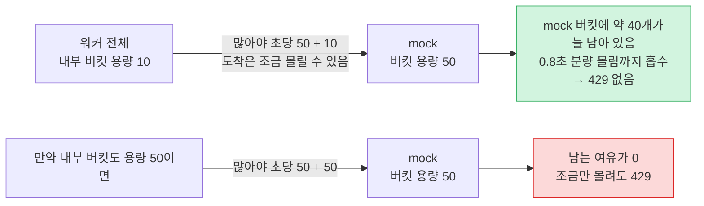

# ADR-0009. 전역 처리량 제한은 모든 워커가 PostgreSQL 단일 토큰 버킷 행을 공유하여 처리한다

## 배경

외부 발송 API는 초당 50건을 초과하면 `429`로 거절한다. 이 제한은 워커 대수와 무관하게 전체 워커 합산 기준으로 준수해야 한다. 워커 3대가 각자 초당 50건씩 발송하면 합계 150건이 되어 `429` 오류가 다량 발생한다.

## 결정

토큰 버킷을 PostgreSQL에 단일 행으로 두고, 모든 워커가 발송 전에 이 행에서 토큰을 할당받는다.

- 충전 속도는 초당 50개, 버킷 용량은 10개다.
- 워커는 `n = min(동시 발송 여유 슬롯 수, 10)`개를 요청하고, 단일 `UPDATE`로 `min(n, 잔여 토큰)`개를 할당받는다.
- 할당받은 개수만큼 `Delivery`를 점유(claim)하여 즉시 발송한다. 점유할 대상 건이 부족해 남은 토큰은 폐기한다. 대기 중인 작업이 없을 때만 발생하므로 처리량 손실은 없다.
- `429` 응답을 받으면 버킷 행에 일시 정지 해제 시각(현재 시각 + `Retry-After`)을 기록한다. 모든 워커가 동일한 행을 참조하므로 함께 발송을 멈춘다. 서킷 브레이커의 차단 시각도 동일한 컬럼을 사용한다(ADR-0014).
- 개별 워커는 전체 워커가 몇 대인지 알 필요가 없다.

mock 서버의 처리량 제한도 토큰 버킷(용량 50, 초당 50개 충전, 거절된 요청은 토큰 미차감)으로 동작하므로([mock-observations.md](../mock-observations.md)) 동일한 규칙으로 맞춘다.

## 상세

### 토큰 계산: 요청 시점 지연 충전 (Lazy Refill)

토큰을 주기적으로 채우는 별도 타이머나 백그라운드 작업은 없다. 버킷 행에는 잔여 토큰(`tokens`, 소수 허용), 마지막 충전 시각(`refilled_at`), 일시 정지 해제 시각(`paused_until`), 서킷 브레이커 상태(`breaker_open`, `probe_until`) 컬럼만 둔다. 토큰 요청이 들어오면 단일 `UPDATE` 안에서 마지막 충전 시각 이후 경과한 시간만큼 토큰을 충전하고 지급한다(lazy refill).

#### 1. 가용 토큰 계산 (Lazy Refill)

$$\text{가용 토큰} = \min\Big(\text{용량},\; \text{tokens} + (\text{현재 시각} - \text{refilled\_at}) \times \text{충전 속도}\Big)$$

#### 2. 상황별 토큰 지급 개수 (`granted`)

| 현재 상태 / 조건 | 지급 개수 (`granted`) | 설명 |
| :--- | :---: | :--- |
| **일시 정지 중** (`ts < paused_until`) | `0` | 429 수신 또는 브레이커 정지 대기 중 |
| **프로브 시험 발송 진행 중** (`breaker_open` AND `ts < probe_until`) | `0` | 다른 워커의 프로브 결과 대기 중 |
| **서킷 브레이커 OPEN** (`breaker_open`) | $\min(1, \lfloor\text{가용 토큰}\rfloor)$ | 단 1건의 프로브 시험 발송만 허용 ([ADR-0014](0014-retry-backoff-and-send-circuit-breaker.md)) |
| **일반(정상) 발송** | $\min(n, \lfloor\text{가용 토큰}\rfloor)$ | 요청 슬롯 수($n$)와 가용 정수 토큰 중 최솟값 |

#### 3. 갱신 저장 및 반환값

* **행 갱신 (`UPDATE rate_limiter`)**:
  * $\text{tokens} = \text{가용 토큰} - \text{지급 개수}$
  * $\text{refilled\_at} = \text{현재 시각 } (\text{clock\_timestamp()})$
* **반환값 (`AcquireResult`)**:
  * `granted`: 지급된 토큰 수
  * `wait_ms`:
    * 정지/프로브 중: 남은 해제 시각까지의 시간
    * 잔여 토큰 $< 1$: 다음 1개 토큰 생성 시점까지의 시간 ($\frac{1 - \text{잔여 토큰}}{\text{충전 속도}} \times 1000\text{ms}$)
    * 잔여 토큰 $\ge 1$: `0` (대기 없이 즉시 다음 작업)

- 별도의 충전 주체가 없으므로 충전 프로세스가 중단될 위험도 없다.
- 기준 시계는 DB 시계 하나다. 트랜잭션 시작 시각에 고정되는 `now()`는 사용하지 않고, 호출 시점의 실제 시각인 `clock_timestamp()`를 사용한다.
- 동시 요청은 행 잠금으로 직렬화되어 계산되므로 동일 토큰이 중복 지급되지 않는다.

### 토큰 요청 후 재시도(폴링) 대기 전략

| 할당 결과                                         | 워커 동작                                                                                                                                                                                                                                                  |
| ------------------------------------------------- | ---------------------------------------------------------------------------------------------------------------------------------------------------------------------------------------------------------------------------------------------------------- |
| 할당 성공 및 버킷에 잔여 토큰 존재                | 대기 없이 즉시 재요청한다                                                                                                                                                                                                                                  |
| 할당 성공 및 버킷 소진                            | 다음 토큰 생성 시점까지 대기(sleep)한 뒤 요청한다. 즉시 재요청하면 거의 항상 0개가 반환되기 때문이다                                                                                                                                                       |
| 0개 할당 (다른 워커가 먼저 소진)                  | 백오프(backoff)를 적용한다. 처음에는 다음 토큰 생성 시점까지(최소 5ms) 대기하고, 연속으로 0개를 받으면 대기 시간을 2배씩 늘린다(상한 100ms). 실제 대기 시간은 해당 값의 50~100% 사이에서 무작위(jitter)로 결정하며, 토큰을 할당받으면 초기 상태로 돌아간다 |
| 0개 할당 (일시 정지 중이거나 프로브 결과 대기 중) | 해제 시각까지 최대 0.5초 단위로 나누어 대기(sleep)하며 상태를 재확인한다                                                                                                                                                                                   |

**백오프를 적용하는 이유**: 0개 반환은 다른 워커가 동일한 토큰을 먼저 가져간 경합 충돌이다. 다음 토큰 생성 시점(20ms)까지만 단순 대기하면 워커들이 20ms마다 같은 행을 동시에 갱신(폴링)하여 불필요한 빈손 갱신이 워커 수만큼 증가한다. 이더넷이 충돌할 때마다 대기 범위를 2배로 넓히는 것과 동일한 방식으로, 경합이 없으면 즉시 반응하고 경합이 심할수록 갱신 빈도를 낮춘다. 대기하는 동안 토큰이 쌓이므로 1회 요청 시 할당받는 개수도 늘어난다. 긴급 알림이 이로 인해 추가로 대기하는 시간은 상한인 100ms까지이며, 문자 알림에서 지연으로 체감되지 않는 수준이다.

## 근거

### 설정값: 충전 속도 초당 50, 내부 버킷 용량 10

- **안전 여유는 충전 속도가 아니라 버킷 용량으로 확보한다.** 충전 속도를 45로 낮추면 전체 처리량이 10% 감소한다(10만 건 기준 33분이 37분으로 증가).
- **내부 버킷 용량이 mock보다 작아야 요청 쏠림(burst)을 흡수한다.** 토큰을 할당받은 시점과 요청이 mock에 도달하는 시점 사이에는 점유(claim) 쿼리와 네트워크 지연으로 인한 편차가 존재하여 요청이 몰려 도착할 수 있다. 내부 버킷 용량이 10이면 워커 전체는 "초당 50 + 최대 10"까지만 발송하고, mock은 "초당 50 + 최대 50"까지 허용한다. 결과적으로 mock 버킷에 약 40개가 상시 남아 0.8초 분량의 쏠림을 흡수한다. 내부 버킷 용량도 50으로 두면 두 버킷의 여유가 사라져 약간의 쏠림에도 `429`가 발생한다.
- **버킷 용량은 1회 최대 할당량(10)과 동일하다.** 용량은 일시적으로 누적할 수 있는 상한일 뿐이며, 처리량은 충전 속도가 결정한다. 워커가 지속적으로 토큰을 소비하는 한 초당 50건이 발송된다.
- **1회 최대 할당량이 10개인 이유**: 초당 50건 기준 0.2초 분량이다. 한 번에 많이 할당받으면 특정 워커가 토큰을 독점하고, 긴급 알림이 해당 묶음 뒤에서 대기하게 된다.
- 실측에서 초당 50건을 고르게 발송했을 때 `429`는 0건이었다. 두 값은 환경변수 설정값이며, 외부 서비스가 바뀌면 재측정하여 조정한다.

### 실측 결과

평시에는 토큰이 초당 50개씩만 생성되므로 한 번에 1개 내외의 토큰을 할당받는다. 10개는 발송을 막 시작했거나 일시 정지가 해제된 직후처럼 토큰이 누적되어 있을 때의 상한이다.

| 측정 항목                                                       | 제어 없음  | 백오프만 적용 | 백오프 + 버킷 소진 시 대기 |
| --------------------------------------------------------------- | ---------- | ------------- | -------------------------- |
| 버킷 행 갱신, 초당 49건 발송, 워커 2대                          | 초당 159회 | 초당 155회    | 초당 72회                  |
| 버킷 행 갱신, 초당 49건 발송, 워커 3대                          | 초당 212회 | 미측정        | 초당 94회                  |
| 0개를 받은 요청, 워커 3대, 300건(제한을 초당 100건으로 둔 시험) | 약 730건   | 약 350건      | 약 270건                   |
| 0개를 받은 요청, 워커 2대, 초당 50건                            | 미측정     | 약 390건      | 약 195건                   |

모든 갱신은 인덱스를 수정하지 않는 HOT(Heap-Only Tuple) 갱신이었으며, 처리 시간과 처리량은 변하지 않았다.

## 검토한 대안

- **워커 수로 나누어 개별 제한**: 50을 활성 워커 수로 나누어 각자 준수한다. 공유 행이 없다는 장점이 있으나 유휴 워커의 할당량이 버려진다. 워커 수가 변하는 순간에는 워커마다 변화를 감지하는 시점이 달라 합계가 50을 초과할 수 있으며, `429`가 발생해도 해당 응답을 받은 워커만 멈춘다.
- **충전 속도를 낮춰 여유 확보(초당 45)**: 처리량을 10% 잃는다. 동일한 여유를 버킷 용량 설정으로 얻을 수 있다.
- **내부 버킷 용량도 mock과 동일한 50으로 설정**: 요청 쏠림을 흡수할 여유가 없다.
- **할당량을 리스 방식으로 대여(Google Doorman)**: DB 쓰기를 가장 크게 줄이지만 할당량을 나누고 회수하는 로직이 추가된다. 처리량이 초당 50건으로 고정된 현재 규모에는 과도하다.
- **미래 토큰 사전 예약(Guava RateLimiter)**: 0개 할당 요청은 사라지지만, 예약 후 대기하는 사이에 `429` 정지가 걸리는 경우를 별도로 처리해야 한다.
- **지정된 시간만큼 모았다가 할당(Kafka `linger.ms`)**: 경합이 없을 때도 항상 해당 시간만큼 대기한다.
- **DB가 토큰 생성까지 요청을 블로킹**: 대기하는 동안 DB 연결을 점유한다.
- **토큰이 쌓일 때까지 기다렸다 묶어서 할당**: DB 왕복은 줄지만 그만큼 긴급 알림이 지연된다. 묶지 않아도 버킷 행 갱신은 초당 72~94회 수준이라 부담이 없다.
