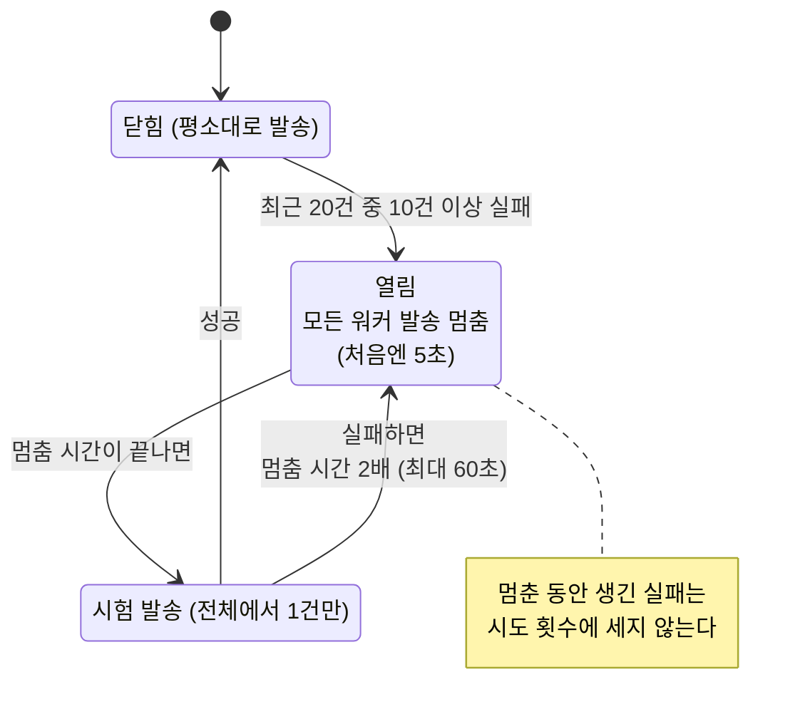
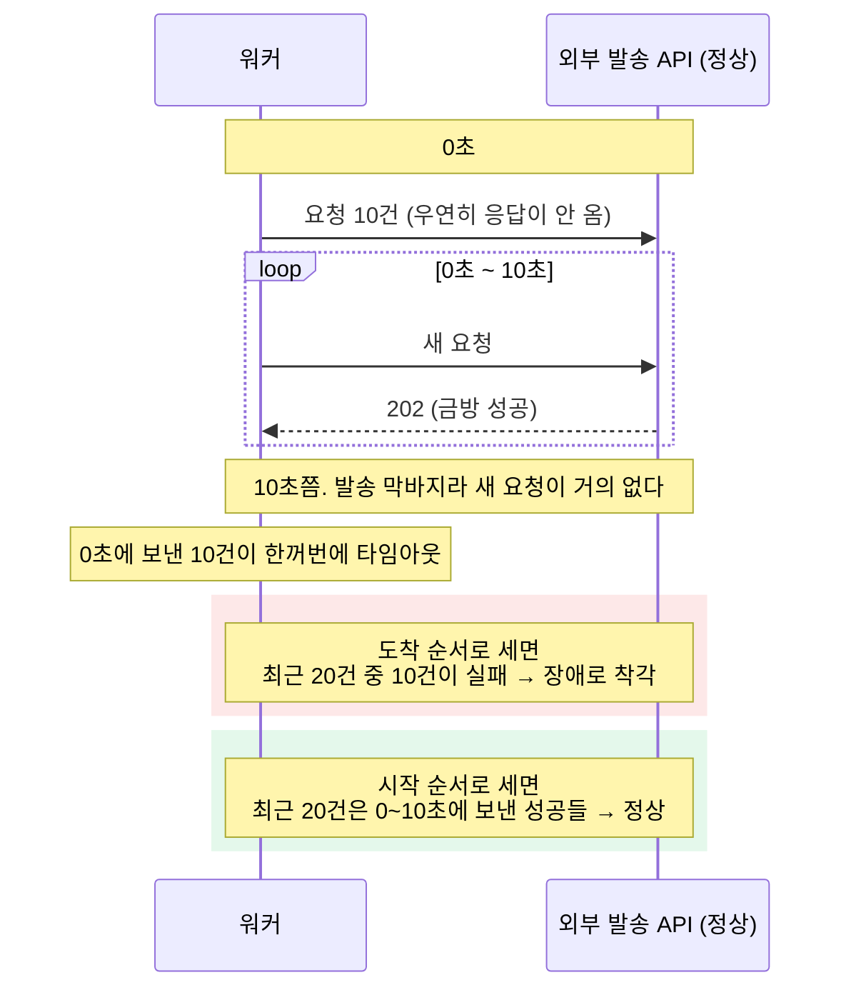

# ADR-0014. 건별 지수 백오프 재시도 및 발송 결과 기반 서킷 브레이커

## 배경

외부 발송 API는 평시에도 약 5%를 `500` 또는 `503`으로 반환한다. 이러한 일시 오류는 재시도로 처리할 수 있으나, 외부 서비스 전체가 수 분간 중단되는 장애 상황에서 건별 재시도만 수행하면 두 가지 문제가 발생한다. 불능 상태인 외부 서비스에 초당 50건의 요청을 지속 전송하게 되고, 재시도 횟수를 소진한 Delivery들이 대량으로 실패(`FAILED`) 확정된다.

## 결정

- **일시 오류는 건별로 지수 백오프(exponential backoff)를 적용해 최대 8회 시도한다.**
- **실패가 집중되어 외부 장애로 판단되면 서킷 브레이커를 개방(open)하여 전체 워커의 발송을 일시 중단한다.**
- **정지 해제 후에는 프로브(probe, 단건 시험 발송) 1건으로 복구 여부를 확인한다.** 전체 워커를 통틀어 1건만 발송하며, 성공 시 브레이커를 닫고 정상 발송을 재개하고 실패 시 정지 시간을 연장한다.
- **서킷 브레이커 개방 중 발생한 실패는 시도 횟수에 반영하지 않는다.** 장애가 장기화되어도 재시도 횟수 소진으로 실패 처리되는 건이 발생하지 않는다.

## 상세

### 응답별 처리

| 결과                                                               | 처리                                                                                                                   | 시도 횟수 반영                              |
| ------------------------------------------------------------------ | ---------------------------------------------------------------------------------------------------------------------- | ------------------------------------------- |
| `202`                                                              | 완료(`SENT`)                                                                                                           | -                                           |
| `400`                                                              | 영구 오류(비재시도성 오류)로 즉시 실패(`FAILED`) 확정. 재시도하지 않음                                                 | -                                           |
| `429`                                                              | 즉시 대기(`PENDING`)로 복귀. 전체 워커 정지는 공유 토큰 버킷이 처리(ADR-0009)                                          | 미반영 (개별 건이 아닌 발송 속도 제한 문제) |
| `500`, `503`, 기타 상태 코드, 요청 전송 전 연결 오류(연결 거부 등) | 백오프 간격 후 재시도                                                                                                  | 반영 (단, 브레이커 개방 중에는 미반영)      |
| 타임아웃, 요청 전송 후 연결 끊김, `502`·`504`, 해석 불가능한 `2xx` | 결과 미확정(`UNCONFIRMED`). 5초 후 발송 내역 조회(상태 확정, Reconciliation)를 수행하여 기록이 없으면 재발송(ADR-0002) | 반영 (단, 브레이커 개방 중에는 미반영)      |

`502`와 `504`는 mock 서버가 아닌 앞단 게이트웨이가 반환하는 응답이다. 요청이 외부 서비스에 도달했는지 확정할 수 없으므로 `500`·`503`과 달리 결과 미확정(`UNCONFIRMED`)으로 분류한다.

### 건별 재시도

- **백오프 간격**: 1초에서 시작해 실패 시마다 2배씩 증가하며 상한은 60초다. 동시에 실패한 건들의 재시도 시점이 몰리지 않도록 매회 ±20% 무작위 지터(jitter)를 적용한다.
- **최대 시도 횟수(8회)**: 8회 시도 후에도 실패하면 `FAILED`로 확정하고 마지막 오류 코드와 메시지를 Delivery에 기록한다(최초 실패로부터 약 2분 소요). 평시 일시 오류율 5% 기준 8회 연속 실패 확률은 사실상 0이므로, 8회 모두 실패한 경우는 일시 오류가 아닌 장애로 간주한다.
- **발송 내역 조회 실패**: 상태 확정(Reconciliation)을 위한 발송 내역 조회가 실패하면 동일한 지수 백오프 간격으로 조회만 재시도하며, 발송 시도 횟수에는 합산하지 않는다. 연속 조회 실패 횟수는 Delivery의 `lookup_failures` 컬럼에 기록한다. 백오프를 적용하지 않으면 외부 장애 동안 결과 미확정(`UNCONFIRMED`) 건마다 초당 1회 조회가 발생하여 복구 직후 외부 서비스에 조회 요청이 집중된다.

### 서킷 브레이커

장애 여부는 외부 서버의 프로세스 생존 여부가 아니라 실제 발송 결과로 판단한다.

1. **개방 판정**: 워커별 최근 시작한 발송 20건 중 절반(10건) 이상이 `5xx`, 연결 오류, 무응답(타임아웃, 전송 후 연결 끊김)이면 장애로 판단한다. 외부 서비스 중단 시 오류 응답 대신 무응답이 발생하는 경우가 많으므로 무응답을 판정 기준에 포함한다. 평시 오류율 5%에서 20건 중 10건 이상 실패할 확률은 사실상 0이다.
2. **발송 정지**: 브레이커를 개방하고 토큰 버킷의 정지 해제 시각을 갱신하여 모든 워커의 발송을 중단한다(`429` 정지와 동일한 컬럼 사용). 정지 시간은 5초에서 시작해 연속 개방 시마다 2배로 증가하며 상한은 60초다. 개방 상태는 토큰 버킷 행(`breaker_open`)에 저장되어 워커가 토큰을 획득할 때마다 함께 조회한다.
3. **프로브(probe, 단건 시험 발송 / half-open)**: 정지 시간이 경과해도 `breaker_open`이 열려 있으면 전체 워커를 통틀어 토큰을 1개만 발급하고 해당 건을 프로브로 지정한다(`probe_until` 컬럼에 만료 시각 기록). 프로브가 성공하면 브레이커를 닫고, 실패하면 정지 시간을 2배로 늘려 다시 개방한다. 프로브를 맡은 워커가 결과를 기록하지 못하고 종료되면 리스 만료 시각(발송 리스와 동일한 30초) 경과 후 다른 워커가 다시 프로브를 수행한다. 장애 지속 중 외부 서비스로 전송되는 요청은 정지 해제 시점마다 1건뿐이다.
4. **개방 중 실패의 시도 횟수 제외**: 브레이커가 열린 동안 기록되는 `5xx`와 연결 오류는 시도 횟수를 원복하고 `PENDING`으로 되돌린다. 시도 횟수를 모두 소진한 상태였더라도 실패로 확정하지 않는다. 무응답은 전송 여부 미확정이므로 결과 미확정(`UNCONFIRMED`)으로 두되 시도 횟수는 원복한다. 해당 실패는 개별 건의 문제가 아니라 외부 장애로 인한 것이기 때문이다(`429`를 시도 횟수에 세지 않는 것과 동일한 이유). 브레이커가 닫힌 평시 실패는 그대로 합산하므로 일시 오류가 8회 연속 발생한 건은 정상적으로 `FAILED` 확정된다.
5. **개방 이전 시작된 요청 결과 배제**: 워커는 브레이커 개방 시각을 기록하고, 그 이전에 시작한 요청의 결과는 판정 윈도우에 반영하지 않는다. 브레이커가 닫히면 판정 윈도우를 비운다. 정지 이전에 전송된 요청이 응답 타임아웃(10초)을 채우고 순차 반환되어 윈도우를 실패로 채우면 정지 해제 직후 브레이커가 즉시 재개방되기 때문이다.

정지 중에는 워커가 Delivery를 점유(claim)하지 않으므로 대기 건의 시도 횟수가 소모되지 않는다. 대체 발송 경로가 없으므로 정지 중 대응은 대기 후 재발송이다.

### 오탐(False Positive) 방지

외부 서비스가 정상임에도 판정 윈도우가 실패로 채워지는 두 가지 경우를 방지한다.

- **결과 도착 순서가 아닌 요청 시작 순서로 집계한다**: 성공 응답은 수십 ms 내에 반환되는 반면 타임아웃은 응답 제한 시간(10초) 후에 반환된다. 도착 순서로 집계하면 알림 발송 막바지나 `429` 정지 시점처럼 신규 발송이 급감할 때 새로운 성공 응답은 유입되지 않고 10초 전에 전송한 요청의 타임아웃만 집중 반환되어 윈도우의 절반을 채운다. 요청 시작 순서로 집계하면 이러한 타임아웃은 이미 윈도우 범위보다 오래된 요청이므로 제외되며, 실제 장애 시에는 새로 전송한 요청이 모두 실패하므로 정상 감지된다.
- **타이머 만료 시 이벤트 루프를 1회 양보(yield)한다**: 응답 제한 시간보다 오래 멈췄다가 재개된 프로세스는 만료된 타이머를 소켓 I/O보다 먼저 실행하여 이미 수신된 응답까지 타임아웃으로 처리한다. 타이머 만료 후 1회 양보하여 그사이 도착한 소켓 응답을 먼저 읽도록 한다. 워커 1대를 45초씩 3회 일시 정지·재개하는 시험에서 양보 미적용 시 재개마다 타임아웃이 7~10건 발생해 브레이커가 개방되었으며, 양보 적용 시 0건이었다.

첫 번째 경우(도착 순서로 집계할 때의 오탐)를 그림으로 나타내면 다음과 같다.

## 근거: 외부 서비스의 `/health`를 장애 판정에 사용하지 않는 이유

mock 서버는 `GET /health`를 제공하며 Docker Compose 기동 순서 제어용으로 안내한다. 애플리케이션도 기동 순서 제어(`depends_on: condition: service_healthy`)에는 이를 사용하지만, 런타임 발송 장애 판정에는 사용하지 않는다.

- `/health`는 프로세스가 요청에 응답한다는 점만 보장한다. 발송 API만 `500`이나 `503`을 반환하는 부분 장애에서도 `/health`는 `200`을 반환한다.
- `/health`와 발송 결과를 함께 참조하면 두 신호가 불일치할 때 어느 쪽을 우선할지 결정하는 규칙이 추가로 필요하다. 발송 결과 단일 기준으로 판정하면 이러한 충돌이 발생하지 않는다.
- 실제 외부 발송 서비스(FCM, SENS)는 클라이언트 호출용 헬스체크 API를 제공하지 않으므로 발송 결과로 판정하는 방식이 운영 환경과 동일하게 동작한다.
- `/health`를 주기적으로 호출하는 별도 감시 루프가 불필요하다(ADR-0005).

## 검토한 대안

- **외부 서비스의 `/health`로 장애 판정**: 프로세스 생존 여부만 확인할 수 있어 발송 API 부분 장애를 감지할 수 없다.
- **건별 시도 횟수만으로 처리(전체 정지 없음)**: 장애가 2분 이상 지속되면 그동안 점유(claim)한 건들이 시도 횟수를 모두 소진해 대량 실패 처리되며, 중단된 서비스에 초당 50건을 계속 전송한다.
- **정지 해제 시 즉시 평시 속도로 발송 재개**: 정지가 풀릴 때마다 모든 워커가 중단된 서비스에 동시성 한도만큼 요청을 일제히 전송한다. 점유(claim) 순서가 동일하여 매번 앞쪽 건이 반복 선택되므로 장애가 길어지면 해당 건들이 재시도 횟수를 소진해 실패 확정된다(300초 단절 시험에서 확인).
- **장애 중 실패도 시도 횟수에 합산**: 외부 장애로 인한 실패임에도 장애가 길어지면 재시도 한도를 소진해 `FAILED`로 확정된다.

## 재검토 조건

대체 발송 채널(예: 푸시 실패 시 SMS 전환)이 도입되면 정지 동안 대기하는 대신 대체 채널로 우회하도록 변경한다.
