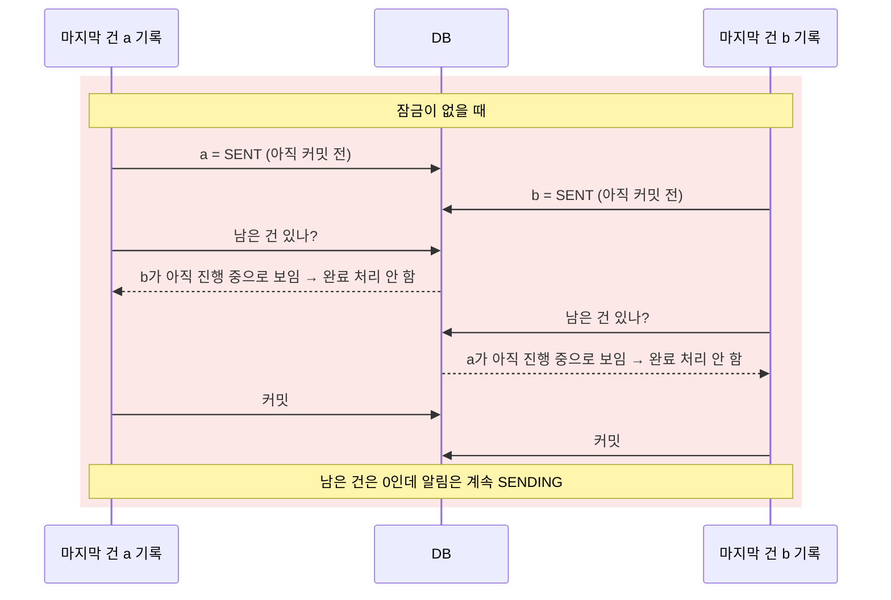
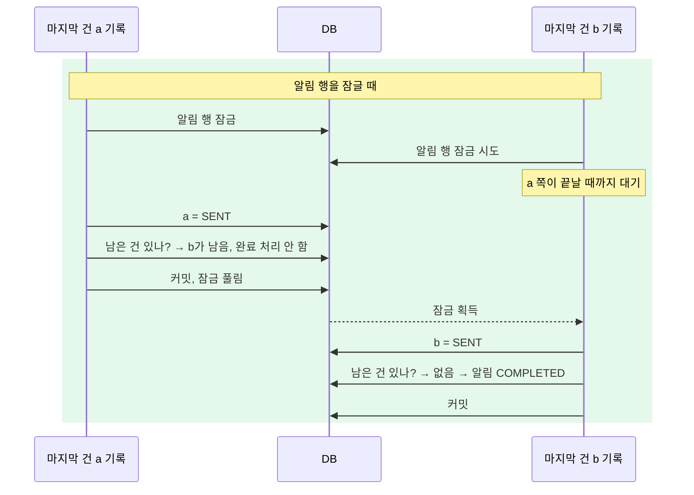

# ADR-0018. 조회 시점 동적 건수 집계 및 마지막 기록 트랜잭션 내 완료 판정

## 배경

알림 단건 조회는 상태별 Delivery 건수(`SENT`, `FAILED` 등)를 반환해야 하며, 모든 Delivery 처리가 종결되면 알림 상태를 `COMPLETED`(또는 `CANCELED`)로 전이해야 한다. 복수의 워커가 동시에 Delivery 결과를 기록하므로 마지막 건의 완료 시점을 누락 없이 감지해야 한다. 잠금 없이 마지막 두 건이 동시에 기록되면 두 트랜잭션 모두 상대방 건을 미완료로 조회하여 완료 전이를 누락할 수 있다.

## 결정

- **상태별 건수**: 별도 카운터 컬럼에 저장하지 않고 알림 단건 조회 시점에 Delivery 테이블을 `GROUP BY status`로 집계한다.
- **완료 판정**: Delivery를 종료 상태(`SENT`, `FAILED`, `CANCELED`)로 갱신하는 트랜잭션이 알림 행을 배타 잠금(`FOR UPDATE`)하고, 동일 트랜잭션 내에서 미완료 건 존재 여부를 확인하는 조건부 `UPDATE`로 알림 완료 상태를 전이한다.

## 상세

### 조회 시점 동적 집계

- `(alarm_id, status)` 복합 인덱스를 사용하므로 10만 건 기준 수십 ms 내에 집계된다.
- 알림 목록 조회는 알림 상태만 반환하며 상태별 Delivery 건수는 포함하지 않는다.
- 집계 카운터를 별도 저장하면 동일 데이터가 중복 관리된다. Delivery 상태를 변경하는 경로 중 하나라도 카운터 갱신을 누락하면 영구적인 정합성 불일치가 발생한다(ADR-0003 단일 원본 원칙). 파생 집계 저장은 성능상 이점이 명확할 때만 제한적으로 도입한다(예외: ADR-0031).

### 마지막 결과 기록 트랜잭션의 완료 판정

Delivery를 종료 상태로 변경하는 모든 경로는 동일한 함수를 통해 단일 트랜잭션으로 실행된다.

1. 대상 알림 행을 배타 잠금(`SELECT ... FOR UPDATE`)한다.
2. Delivery 상태 변경을 기록한다.
3. 동일 트랜잭션 내에서 아래 조건부 `UPDATE`를 실행한다.

```sql
UPDATE alarms SET status = 'COMPLETED'          -- CANCELING이면 'CANCELED'
WHERE id = $1 AND status = 'SENDING'
  AND 수신자_확장_완료
  AND NOT EXISTS (미종결 Delivery: PENDING, IN_FLIGHT, UNCONFIRMED)
```





- **알림 행 잠금 이유**: 잠금이 없으면 마지막 두 건이 동시에 기록될 때 각 트랜잭션이 상대 트랜잭션의 미커밋 행을 진행 중으로 읽어 양쪽 모두 완료 전이를 건너뛴다. 알림 행을 잠그면 동일 알림에 대한 결과 기록이 직렬화된다(순차 대기한다). 후행 트랜잭션은 선행 트랜잭션의 커밋 결과를 확인한 뒤 조건을 평가하므로(PostgreSQL 기본 격리 수준인 `READ COMMITTED`는 문장 단위로 최신 커밋 스냅숏을 읽음) 마지막 기록 트랜잭션이 정확히 미종결 건 없음을 감지한다.
- **동일 트랜잭션 처리 이유**: 결과 기록과 완료 판정이 원자적으로 묶여 두 단계 사이에 프로세스가 비정상 종료되는 틈이 발생하지 않는다. 따라서 누락된 완료 판정을 보정하기 위한 주기적 폴링 쿼리가 필요 없다.
- **전체 건수 비교 대신 `NOT EXISTS` 사용**: 수신자 확장(Expansion) 진행 중에는 전체 수신자 수가 확정되지 않는다. `NOT EXISTS`는 미종결 행을 1건만 찾으면 즉시 탐색을 중단하며, 미종결 상태만 포함하는 부분 인덱스(partial index)를 타므로 발송 후반부로 갈수록 조회 비용이 0에 수렴한다.
- **적용 경로**: 발송 결과 기록, 발송 내역 조회(상태 확정, Reconciliation) 결과 기록, 취소 시 대기 건 일괄 정리, 수신자 확장 종료.

## 결과 및 한계

동일 알림에 대한 결과 기록 트랜잭션이 알림 행 잠금을 기준으로 직렬화된다(순차 대기한다). 결과 기록은 건당 1개 트랜잭션으로 초당 약 50회 직렬화되지만, 개별 트랜잭션이 단일 행 갱신과 부분 인덱스 `NOT EXISTS` 확인으로 짧게 끝나므로 전체 처리량은 상한에 근접하게 유지된다(실측 초당 49건). 단, 잠금 대기 동안 DB 커넥션을 점유하므로 워커 작업 루프에는 전용 커넥션 풀을 분리하여 할당한다(ADR-0013).

## 검토한 대안

- **워커가 1초 주기로 완료 조건 폴링**: 정합성은 보장되나 상시 폴링 쿼리가 실행되고 완료 상태 반영이 최대 1초 지연된다.
- **알림 행에 건수 카운터 컬럼 유지**: 조회와 완료 판정이 즉시 수행되지만 원본 데이터와 카운터 간 정합성 불일치 위험이 상존한다.
- **결과 기록 커밋 후 별도 쿼리로 완료 확인**: 마지막 커밋 트랜잭션 이후 시점에는 모든 변경이 보이므로 판정 자체는 가능하나, 커밋 직후 확인 쿼리 실행 전에 프로세스가 종료되면 완료 전이가 누락되어 별도 복구 루프가 필요하다.
