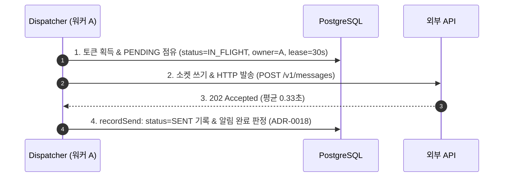
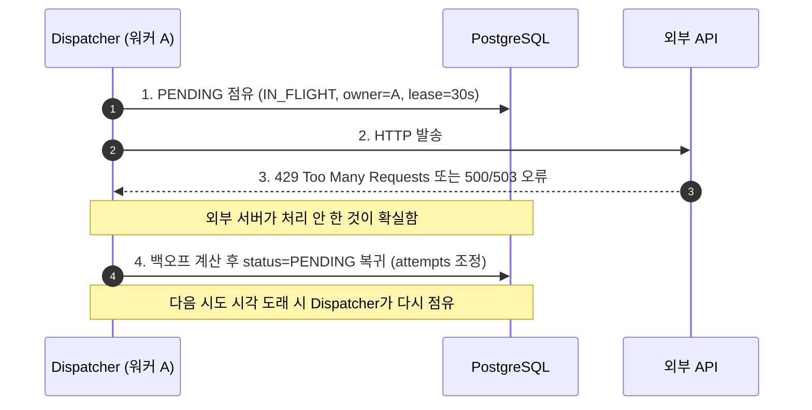
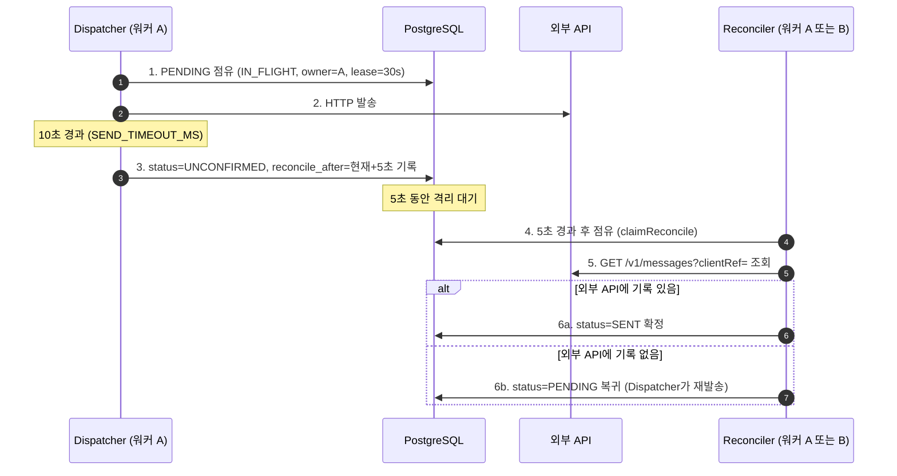
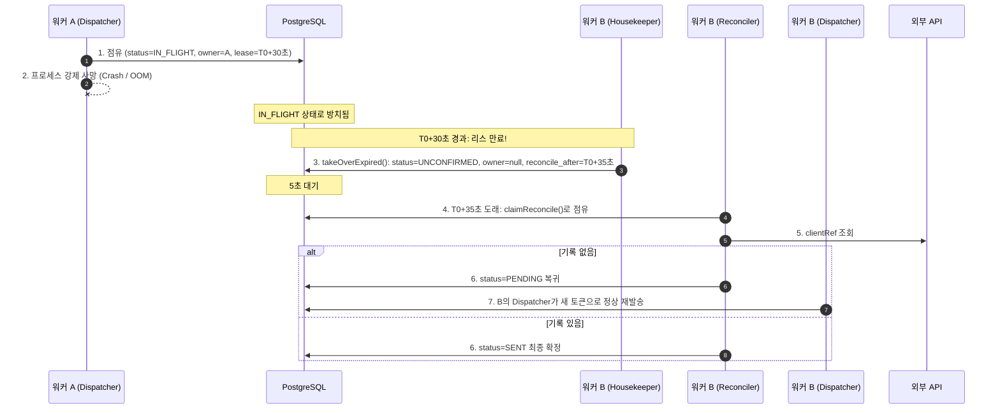
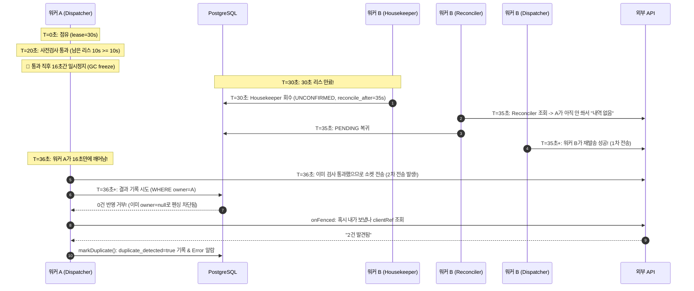
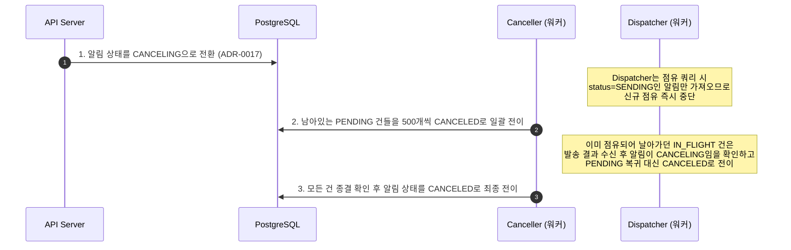

# 워커 내부 루프(~er) 구성 및 책임 매핑

단일 워커 프로세스([ADR-0010](0010-two-workers-one-process-per-container.md)) 내에서 독립된 비동기 폴링 루프([ADR-0039](0039-unexpected-errors-never-kill-the-process.md))로 동작하는 5개 컴포넌트의 역할, 처리 대상 상태 및 관련 ADR 정리 문서다.

전체 모듈 조립 구조는 [structure.md](../structure.md)와 [WorkerRuntime](../../src/worker/runtime/worker-runtime.ts)을 참고한다.

---

## 1. 워커 5대 컴포넌트 요약표

| 컴포넌트 | 핵심 역할 | 주 대상 상태 | 관련 ADR | 코드 경로 |
| :--- | :--- | :--- | :--- | :--- |
| **`Dispatcher`**<br/>(발송기) | • 공유 토큰 버킷에서 토큰 획득<br/>• 우선순위순 Delivery 점유(`claim`)<br/>• 소켓 쓰기 직전 잔여 리스 검증<br/>• 외부 HTTP 발송 및 단건 결과 DB 기록 | `PENDING`<br/>→ `IN_FLIGHT`<br/>→ `SENT` / `UNCONFIRMED` | [ADR-0004](0004-ownership-by-lease-and-fencing.md) (리스/펜싱)<br/>[ADR-0009](0009-shared-token-bucket-in-postgres.md) (토큰버킷)<br/>[ADR-0011](0011-urgent-first-by-claim-order.md) (긴급우선)<br/>[ADR-0012](0012-fifo-between-alarms-within-priority.md) (순번정렬)<br/>[ADR-0013](0013-concurrency-cap-and-socket-pool.md) (동시성/소켓풀)<br/>[ADR-0014](0014-retry-backoff-and-send-circuit-breaker.md) (서킷브레이커) | `src/worker/dispatch/dispatcher.ts` |
| **`Housekeeper`**<br/>(회수기) | • 2초 주기로 만료 리스(`lease_until < now`) 탐색<br/>• 장애 워커의 점유 건 인계(`takeOverExpired`)<br/>• `owner = null` 초기화 및 1차 전이 | `IN_FLIGHT`<br/>→ `UNCONFIRMED` | [ADR-0004](0004-ownership-by-lease-and-fencing.md) (작업 인계)<br/>[ADR-0007](0007-worker-shutdown-two-exits.md) (워커 종료 회수) | `src/worker/lifecycle/housekeeper.ts` |
| **`Reconciler`**<br/>(상태 확정기) | • 5초 대기 경과(`reconcile_after <= now`) 건 점유<br/>• `clientRef`로 외부 API 발송 내역 조회<br/>• 결과에 따라 종결 확정 또는 재발송 대기로 복귀 | `UNCONFIRMED`<br/>→ `SENT`<br/>또는 `PENDING` | [ADR-0002](0002-reconcile-unconfirmed-sends-via-clientref.md) (역조회 확정)<br/>[ADR-0032](0032-delivery-status-model.md) (상태 모델) | `src/worker/reconcile/reconciler.ts` |
| **`Expander`**<br/>(수신자 확장기) | • 전체 발송(Bulk) 알림의 대상자 API 페이징 조회<br/>• 커서 체크포인트 기록하며 `deliveries` 대량 생성<br/>• 알림당 1대 워커만 점유하여 중복 확장 방지 | `Alarm` (`SENDING`)<br/>→ `Delivery` (`PENDING`) | [ADR-0006](0006-recipient-expansion-single-owner-with-cursor-checkpoint.md) (커서 체크포인트) | `src/worker/expansion/expander.ts` |
| **`Canceller`**<br/>(취소 정리기) | • 사용자가 알림 취소 시 2단계 비동기 정리 수행<br/>• 아직 발송 안 된 잔여 건들을 일괄 취소 전이 | `PENDING`<br/>→ `CANCELED` | [ADR-0017](0017-cancel-in-two-steps.md) (2단계 발송 취소) | `src/worker/cancellation/canceller.ts` |

---

## 2. 상태 전이와 루프 간 상호작용

```mermaid
flowchart TD
    subgraph 생성
        EXP["Expander"] -->|사용자 API 페이징 조회| P1["PENDING"]
    end

    subgraph 발송 및 회수
        P1 -->|Dispatcher: claim 점유| IF["IN_FLIGHT"]
        IF -->|Dispatcher: 202 응답 성공| SENT["SENT (최종 종결)"]
        IF -->|Dispatcher: 타임아웃 / 단절| UNCONF["UNCONFIRMED (5초 대기)"]
        IF -->|Housekeeper: 리스 만료 회수| UNCONF
    end

    subgraph 상태 확정
        UNCONF -->|Reconciler: 내역 있음| SENT
        UNCONF -->|Reconciler: 내역 없음 (시도 남음)| P1
    end

    subgraph 취소
        P1 -->|Canceller: 알림 취소 정리| CANC["CANCELED (최종 종결)"]
    end

    classDef done fill:#22c55e33,stroke:#16a34a
    classDef stop fill:#ef444433,stroke:#dc2626
    class SENT done
    class CANC stop
```

---

## 3. 공통 기반 및 설계 원칙

1. **에러 격리 폴링 루프 ([ADR-0039](0039-unexpected-errors-never-kill-the-process.md))**:
   * 모든 컴포넌트는 `PollingLoop` 기반으로 구동되며, 개별 루프에서 예외가 발생해도 로깅 후 다음 주기를 재개하여 워커 프로세스가 죽지 않는다.
2. **동시성 및 펜싱 ([ADR-0004](0004-ownership-by-lease-and-fencing.md), [ADR-0016](0016-state-transitions-by-conditional-update.md))**:
   * 모든 상태 전이는 DB 조건부 `UPDATE`(`WHERE owner = ... AND attempts = ...`)로 실행되며, 지연된 워커의 쓰기는 0건 반영으로 안전하게 거부된다.
3. **최종 완료 판정 ([ADR-0018](0018-derived-counts-and-last-writer-completion.md))**:
   * `Dispatcher`, `Reconciler`, `Canceller`가 종료 상태(`SENT`, `FAILED`, `CANCELED`)를 기록할 때 동일 트랜잭션 내에서 알림 행을 잠그고(`withAlarmLock`), 미종결 건이 0건이면 알림을 `COMPLETED`로 전환한다.

---

## 4. 상황별 협업 시나리오 (Scenarios)

### 시나리오 1: 정상 발송 (Happy Path)

가장 일반적인 경우. `Housekeeper`와 `Reconciler`는 전혀 개입하지 않는다.



1. **`Dispatcher`**가 DB에서 `PENDING`을 `IN_FLIGHT`로 점유(리스 30초 부여).
2. 외부 API로 전송.
3. `202 Accepted` 응답 수신.
4. **`Dispatcher`** 본인이 직접 DB에 `SENT`를 기록하고 종결.

---

### 시나리오 2: 외부 일시 오류 (429, 500, 503) — "안 간 게 확실함"

외부 서버가 요청을 명확히 거부했으므로 조회가 불필요하다. `Dispatcher`가 즉시 처리한다.



1. 외부 API가 `429` 또는 `5xx` 반환 -> 외부 DB에 기록이 안 남은 것이 확실함.
2. **`Dispatcher`**가 다음 시도 시각(`next_attempt_at`)을 걸어 **`PENDING`**으로 되돌린다.
3. 쿨다운 후 **`Dispatcher`**가 다시 가져가서 재발송한다. (`Reconciler` 불필요)

---

### 시나리오 3: 응답 타임아웃 (워커는 정상, 리스 잔여 내 DB 기록) — "갔는지 모름"

워커 A가 정상 작동하여 10초 타임아웃 시점(남은 리스 20초)에 직접 DB를 갱신하는 경우. `Housekeeper` 없이 **`Dispatcher`와 `Reconciler`가 협업**한다.
*(만약 워커 A가 지연/정지로 30초 리스 만료 전까지 DB 기록을 못 마쳤다면, 시나리오 4처럼 `Housekeeper`가 개입하여 회수한다.)*



1. 10초 타임아웃 발생 시 **`Dispatcher`**가 아직 20초 남은 자신의 리스 권한으로 직접 DB를 **`UNCONFIRMED`**로 변경하고 `reconcile_after = now + 5초`를 설정한다.
2. 5초 뒤, 살아있는 아무 워커의 **`Reconciler`**가 이 건을 가져가 외부 API 내역을 조회한다.
3. 기록 여부에 따라 `SENT`로 끝내거나, `PENDING`으로 돌려 다시 발송하게 만든다.

---

### 시나리오 4: 발송 중 워커 A 급사 (OOM / Crash) — "Housekeeper 출동"

워커 A가 점유 후 발송하다가 강제 종료되어 DB에 아무것도 못 쓴 경우. **`Housekeeper`와 `Reconciler`가 연쇄 복구**한다.



1. 워커 A가 죽어 DB에는 `status = IN_FLIGHT`, `owner = A`가 멈춘 채 남는다.
2. 30초가 지나 리스가 만료되면 워커 B의 **`Housekeeper`**가 감지한다.
3. **`Housekeeper`**가 `takeOverExpired()`를 실행해 `status = UNCONFIRMED`, `owner = null`로 소유권을 박탈하고 5초 뒤(`reconcile_after`)로 밀어둔다.
4. 5초 뒤 워커 B의 **`Reconciler`**가 넘겨받아 외부 조회를 수행하고, 결과에 따라 복구한다.

---

### 시나리오 5: 극단적 일시정지 (ADR-0004 한계점: 15초 좀비 워커)

워커 A가 소켓 쓰기 직전 검사를 통과한 뒤 긴 GC로 15초 이상 멈췄다 깨어났을 때의 중복 발생 및 사후 탐지 메커니즘.



* **한계 및 중복 발생 메커니즘**:
  * 사전 검사(20초) 통과 후 소켓에 바이트를 쓰기 직전 멈추면, 워커 B가 인계(30초) 후 5초 대기 뒤 조회하는 35초 시점까지 외부 API에 요청이 도달하지 못해 **외부 2회 중복 발송이 물리적으로 발생**한다.
  * 15초(35초 - 20초)는 네트워크/외부 처리 지연이 0일 때의 **이론상 최소 정지 시간(Lower Bound)**이며, 외부 전파 지연($\Delta t$)이 있다면 `15초 - \Delta t`만 멈춰도 경합이 발생할 수 있다.
* **시스템의 사후 대응 (발송 차단이 아닌 DB 정합성 및 탐지)**:
  1. **지연 쓰기 차단**: 외부 발송은 이미 2번 나갔으나, 워커 A가 뒤늦게 결과를 기록하려는 **DB UPDATE는 펜싱(`WHERE owner = A`)에 의해 0건 반영으로 거부**된다 (B가 이미 확정한 상태를 덮어쓰지 못함).
  2. **중복 사후 탐지**: 거부당한 A는 `onFenced` 핸들러에서 외부 API를 조회해 2건 전송 사실을 스스로 확인하고, `duplicate_detected = true` 플래그와 Error 메트릭을 남긴다.
  3. **완전 차단 불가의 한계**: 외부 서버에 바이트가 전송되는 것을 클라이언트 단독으로 100% 막으려면 의심 프로세스를 강제 사살(STONITH)해야 하나, 애플리케이션 권한을 넘어서므로 발생률(실측 1~3%)을 감수하고 사후 탐지로 대응한다 ([ADR-0004](0004-ownership-by-lease-and-fencing.md)).

---

### 시나리오 6: 사용자 발송 취소 (Canceller 협업)

발송 중 사용자가 취소 API를 호출했을 때.



1. API가 알림을 `CANCELING`으로 바꾸면 **`Dispatcher`**는 새 점유를 즉시 멈춘다.
2. **`Canceller`**가 아직 출발 안 한 `PENDING` 건들을 일괄 `CANCELED` 처리한다.
3. 이미 통신 중이던 `IN_FLIGHT` 건이 실패하더라도, 재시도(`PENDING`)로 가지 않고 `CANCELED`로 안전하게 떨어진다.
